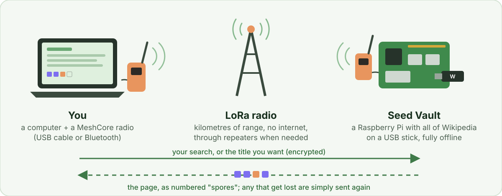
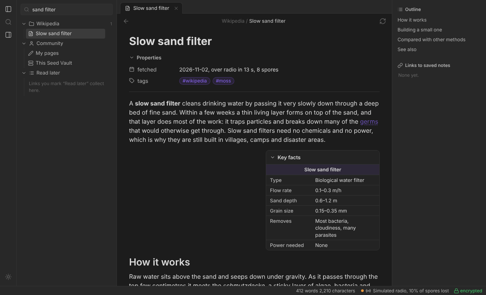
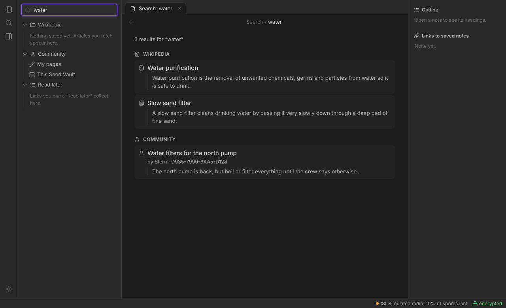
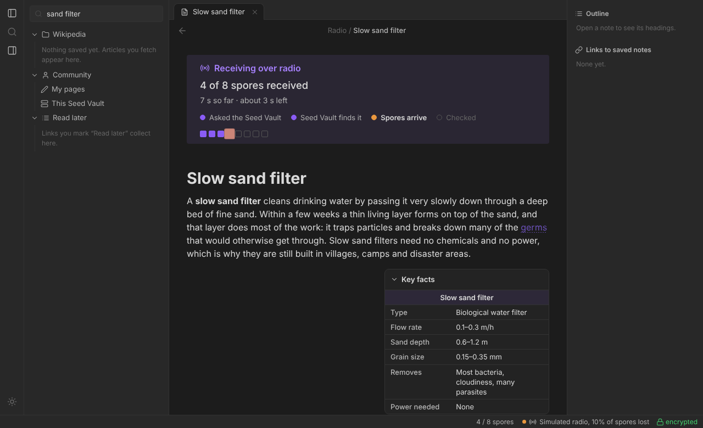
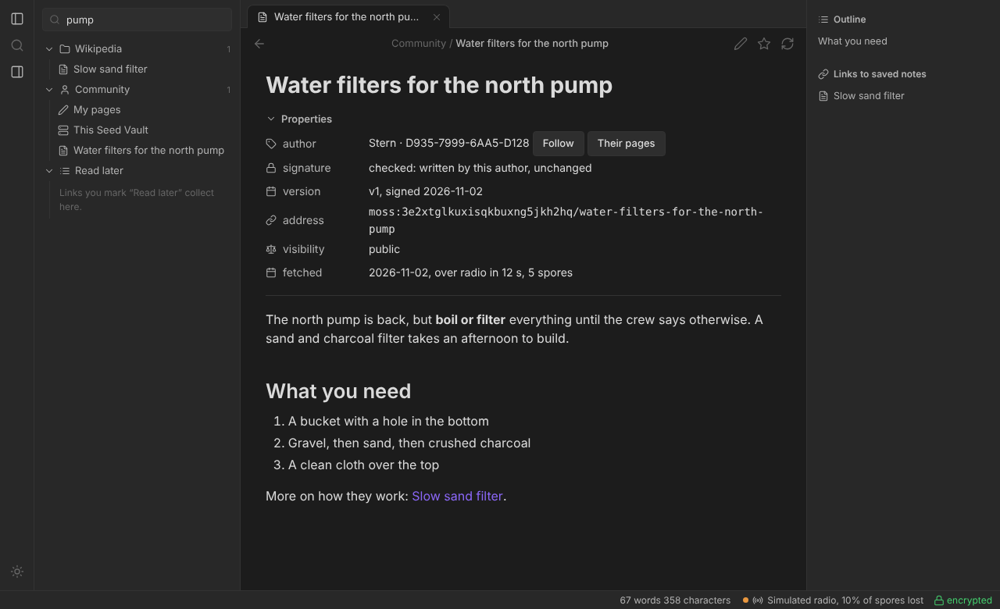
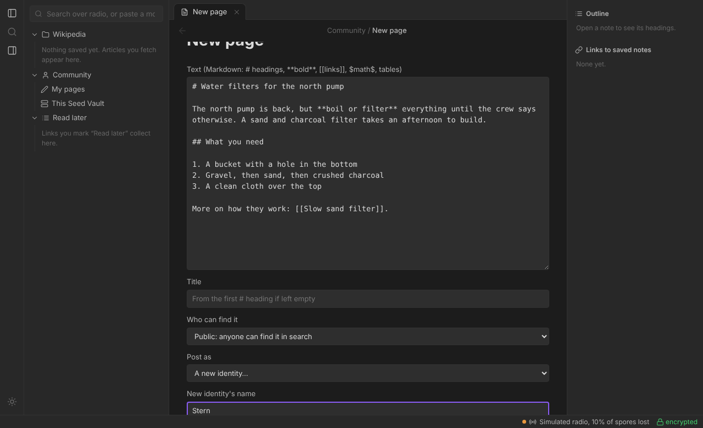
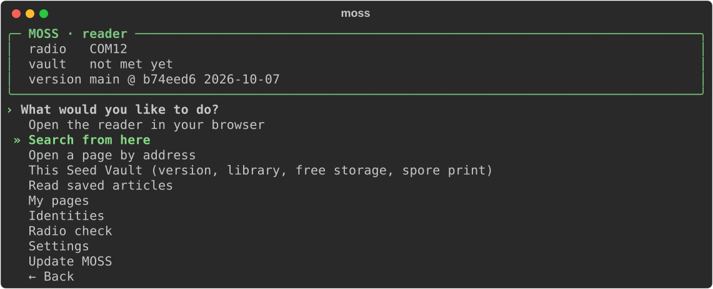

<p align="center">
  
</p>

**MOSS lets you read Wikipedia with no internet at all, over small,
cheap LoRa radios.** Somebody nearby (maybe you) runs a **Seed Vault**:
a Raspberry Pi holding an offline copy of Wikipedia. Anyone with a radio
and a computer can search it from kilometres away and read articles as they
arrive, a piece at a time. People can also publish their own **community
pages** to the vault for others to find.

It runs on [MeshCore](https://meshcore.io/), the open-source radio mesh,
with the radios' standard firmware. What you search for and read is
encrypted: other people on the mesh can't tell what you're reading.

> **Early release.** MOSS works and is tested, but its security hasn't been
> independently reviewed yet. Please don't rely on it where being found out
> could put someone in danger, and please
> [report anything you find](SECURITY.md).

<p align="center">
  
</p>

<p align="center">
  
  <br><sub>The reader, in your browser. (Screenshots use MOSS's simulator and made-up sample articles.)</sub>
</p>

---

## Contents

- [What you can do](#what-you-can-do)
- [A few words MOSS uses](#a-few-words-moss-uses)
- [What you need](#what-you-need)
- [Get started](#get-started)
- [Everyday use](#everyday-use)
- [How fast is it?](#how-fast-is-it)
- [Privacy in one minute](#privacy-in-one-minute)
- [Being a good neighbour on the mesh](#being-a-good-neighbour-on-the-mesh)
- [More documentation](#more-documentation)
- [FAQ](#faq)
- [Credits and licences](#credits-and-licences)

---

## What you can do

- **Search and read Wikipedia** with no internet, in a reader that looks
  and works much like [Obsidian](https://obsidian.md/). Text appears as it
  arrives, so you can start reading straight away.
- **Keep everything you read.** Saved articles open instantly, with no
  radio, and can be exported to an Obsidian vault as linked notes.
- **Keep what matters:** links between articles, formulas, tables and each
  article's key facts all come through.
- **Write your own pages** (notes, local news, how-tos) and publish them to
  the Seed Vault for others to find, or share them by link only.
- **Follow authors** and favourite pages. That stays on your computer and
  is never sent.
- **Read privately.** Searches and pages are encrypted end to end.
- **Use a cable or Bluetooth** to reach your radio, on Windows, Mac or
  Linux.

<table>
  <tr>
    <td width="50%"></td>
    <td width="50%"></td>
  </tr>
  <tr>
    <td align="center"><sub>Search: Wikipedia and community pages together</sub></td>
    <td align="center"><sub>An article arriving, readable while the rest comes in</sub></td>
  </tr>
  <tr>
    <td width="50%"></td>
    <td width="50%"></td>
  </tr>
  <tr>
    <td align="center"><sub>A community page, with its author's signature checked</sub></td>
    <td align="center"><sub>Writing your own page</sub></td>
  </tr>
</table>

---

## A few words MOSS uses

| Word | Means |
|---|---|
| **Seed Vault** | The Raspberry Pi that holds the library and answers everyone's requests. |
| **reader** | You: a computer with a radio, searching and reading. |
| **spore** | One small radio message carrying a slice of a page (up to 158 bytes). A page is sent as numbered spores. |
| **#moss** | The radio channel all MOSS traffic uses. MOSS sets it up for you. |
| **fingerprint** | A short code like `3F9A-12C4-77E0-5B21` that identifies a Seed Vault, so you can check you're talking to the right one. |

There are a few more, all in the [glossary](docs/how-it-works.md#glossary).

---

## What you need

**To read:**

- A **computer**: Windows, Mac or Linux.
- A **MeshCore radio**, for example a Heltec V3 (plugs in by USB) or a
  Seeed T1000-E (Bluetooth). It needs MeshCore's standard **companion**
  firmware, which you install from a web page: the
  [MeshCore web flasher](https://meshcore.io/flasher). Pick *Companion USB*
  for a cable, *Companion Bluetooth* for Bluetooth.
- A **Seed Vault** within radio range, directly or through MeshCore
  repeaters.

**To run a Seed Vault:** a Raspberry Pi, a second radio, and a USB stick
with Wikipedia on it. See [Running a Seed Vault](docs/seed-vault.md).

**No radios yet?** You can try the whole thing on one computer over a
simulated radio; see [Try it without radios](#try-it-without-radios).

---

## Get started

**1. Put the companion firmware on your radio** with the
[MeshCore web flasher](https://meshcore.io/flasher) (in Chrome or Edge).
If you already use the radio with the MeshCore phone app, it's already done.

**2. Install MOSS**, with one command. It asks whether this computer is a
reader or a Seed Vault, finds your radio, and sets everything up.

On **Windows**, in PowerShell:

```powershell
irm https://raw.githubusercontent.com/Obsideaock/MOSS/main/install.ps1 | iex
```

On a **Mac, Linux or a Raspberry Pi**, in Terminal:

```bash
curl -sSL https://raw.githubusercontent.com/Obsideaock/MOSS/main/install.sh | bash
```

(On a Mac you need Python 3.10 or newer. If the installer says yours is too
old, run `brew install python git` first.)

**3. Open a new terminal and type `moss`.** That opens a menu for
everything. Use the arrow keys to move, Enter to pick, and Ctrl+C to go back.

<p align="center">
  
</p>

Pick **Open the reader in your browser**, and search for something.

The first time your reader hears the Seed Vault, it remembers its
**fingerprint**. If you know the vault's owner, ask them for theirs and
check it matches. It's shown when you hover over the lock in the reader's
status bar.

### Try it without radios

From the MOSS folder (`MOSS` in your home folder):

```bash
moss web --sim TestExamples/mini_wikipedia.zim
```

This runs a reader and a pretend Seed Vault on your computer, over a
simulated radio that even loses a few spores on purpose.

---

## Everyday use

Type `moss` for the menu, or use the commands directly:

```bash
moss web                     # open the reader in your browser
moss search "boulder"        # search, pick and read in the terminal
moss cache                   # what you've saved (no radio needed)
moss update                  # get the newest MOSS
```

In the browser reader:

- **Search** with the box at the top left (or Ctrl K). Results show
  Wikipedia articles and community pages.
- **Open** a result to fetch it. A grid of spores fills in as it arrives,
  with a time estimate.
- **Links** to articles you've saved open at once. Other links offer
  **Get it now** or **Read later**.
- **Saved articles** are on the left and open instantly, even with the
  radio unplugged.
- **Community → My pages → New page** to write your own page.

More in the [reader guide](docs/reader-guide.md) and
[community pages](docs/community-pages.md).

---

## How fast is it?

Slow on purpose: LoRa trades speed for range. It reaches kilometres on a
tiny battery, but moves only about **100 bytes of page a second**.

| What | Roughly |
|---|---|
| A search | a few seconds |
| A short article | under half a minute |
| A typical article | 1–2 minutes |
| A very long article | 5–6 minutes |

You can read the top of an article while the rest is still arriving, and
anything you've read before opens instantly. The details, and ways to make
it faster, are in [Speed and airtime](docs/how-it-works.md#speed-and-airtime).

---

## Privacy in one minute

Anyone in radio range can hear MOSS's radio messages, so MOSS encrypts them.

- **Hidden from listeners:** what you searched for, which article or page
  you got, what it says, and any error messages.
- **Still visible:** that someone used MOSS, roughly when, roughly how big
  the page was, and roughly where the radio is (from its signal).
- **Can't be faked:** only the real Seed Vault can answer you. A forged or
  damaged page is thrown away, never shown.
- **The Seed Vault doesn't log** what people search for or read.
- **Your follows and favourites** never leave your computer.
- **Community pages are signed** by their authors, so nobody can change
  one or pretend to be you.

**One thing to check yourself:** MeshCore radios announce their name (and,
if set to, their location) to the whole mesh, separately from MOSS. In the
MeshCore app, turn off sharing your location and don't use your real name
as the radio's name. Details in
[your radio's own announcements](docs/privacy.md#your-radios-own-announcements-adverts).

It uses well-known, standard encryption (the same building blocks as
modern messaging apps), nothing home-made. The full story, including what
the vault's owner can see, is in [Privacy and encryption](docs/privacy.md).

---

## Being a good neighbour on the mesh

MeshCore radio networks are shared, and run by volunteers. MOSS sends a lot
more than a chat message, so it's built to be polite: its own `#moss`
channel (never the Public chat channel), messages that chat apps don't show,
pauses between spores, and re-sending only what went missing.

**If you're going to run a Seed Vault on a shared mesh, talk to your local
MeshCore group first.** There are settings to keep MOSS's traffic local, or
off the shared mesh entirely: see
[Being a good mesh neighbour](docs/seed-vault.md#being-a-good-mesh-neighbour).

---

## More documentation

| Page | What's in it |
|---|---|
| [Reader guide](docs/reader-guide.md) | Installing, Bluetooth radios, updates, the radio check, using the reader, Obsidian, vault specs and spore prints |
| [Community pages](docs/community-pages.md) | Writing, publishing, finding and following pages; identities and backups |
| [Running a Seed Vault](docs/seed-vault.md) | The Raspberry Pi: setup, the USB stick, options, limits, routing, a dedicated link |
| [Privacy and encryption](docs/privacy.md) | What's protected, how, and what isn't |
| [How it works](docs/how-it-works.md) | The radio side, a transfer step by step, message formats, speed and airtime |
| [Reference](docs/reference.md) | Troubleshooting, every command, where files are kept, the code layout |
| [Testing](docs/testing.md) | The automated tests, and testing your own radios |
| [Roadmap](docs/roadmap.md) | What's done, what's next, ideas for later |
| [Security](SECURITY.md) | How to report a security problem privately |

---

## FAQ

**Can other people see what I'm reading?**
No: requests, pages and errors are encrypted end to end. They can see that
someone used MOSS, when, roughly how big the page was, and roughly where the
radio is. See [Privacy and encryption](docs/privacy.md).

**Can the Seed Vault's owner see what I read?**
The Pi has to decrypt your request to answer it, so in principle yes. By
default it doesn't log it, but you're trusting whoever runs the vault.

**What if the Pi is stolen?**
The thief gets its keys. They can't decrypt past replies (those use one-time
keys), but they could decrypt recorded *requests*, and could pretend to be
that vault. The owner should make a new vault key, and readers then run
`moss trust --forget` and check the new fingerprint.

**Do I need a special firmware?**
No. MOSS works with MeshCore's standard companion firmware, the same one
the MeshCore phone app uses.

**Why not just use the Public channel?**
It reaches the whole mesh, carries everyone's chat, and its key is public.
`#moss` is just as easy to join, keeps MOSS traffic separate, and can be
kept to a region.

**Do both sides need internet?**
No. The Pi serves from the file on its USB stick, and the reader's page,
fonts and formulas are all on your computer.

**Can several people use one Seed Vault?**
Yes, one transfer at a time. Others wait their turn (up to six in line),
and the reader shows their place.

**Can there be two Seed Vaults in range?**
Yes. Each reader trusts one, and the other can't read its requests.

**What about images?**
The no-pictures library has none, and a single photo would be dozens to
hundreds of spores. Not planned for now.

**How big can an article be?**
There's no hard limit; the longest Wikipedia articles take several minutes.
A vault's owner can cap article size to save airtime.

**Does it work with other Kiwix libraries?**
Any Kiwix `.zim` file should work (Wiktionary, Wikivoyage, other
languages). Only the English Wikipedia no-pictures file and Kiwix's test
files have been tried.

**Why "spores"?**
Small, numerous, carried on the air, and only a full set grows into the
whole thing.

**Something's not working.**
See [Troubleshooting](docs/reference.md#troubleshooting).

---

## Credits and licences

**MOSS** is free software, copyright (C) 2026 Stern, under the
[GNU General Public License v3.0](LICENSE) or (at your option) any later
version. You can use, change and share it; if you share a changed version,
it has to stay open source under the same licence. It comes with no
warranty.

MOSS builds on:

- Article text is from **Wikipedia**, under CC BY-SA 4.0. Every article
  carries its source link and licence.
- Offline Wikipedia comes from **Kiwix** `.zim` files, read with **libzim**
  (GPL-3.0).
- Radios run **MeshCore**. MOSS talks to them with the `meshcore` Python
  library.
- Formulas are drawn by **KaTeX** (MIT licence), bundled in `moss/static/katex/`.
- Encryption uses **pycryptodome**.
- Icons are from **Lucide** (ISC licence).

The notices these licences ask for are in [THIRD-PARTY-NOTICES.md](THIRD-PARTY-NOTICES.md).

Further reading:

- [MeshCore FAQ](https://docs.meshcore.io/faq/): presets, flooding, hop limits, the Public key
- [MeshCore companion protocol](https://docs.meshcore.io/companion_protocol/): channel slots, channel data, limits
- [MeshCore scopes](https://blog.meshcore.io/2026/04/17/default-scope): keeping floods within a region
- [Hashtag channel keys](https://github.com/TwinRocket/meshloom/issues/71): how a channel's key comes from its name
- [Repeater flood control discussion](https://github.com/meshcore-dev/MeshCore/issues/3278): what heavy flooding does to a mesh
- [RFC 9180 (HPKE)](https://www.rfc-editor.org/rfc/rfc9180): the encryption pattern MOSS follows
- [Kiwix](https://kiwix.org/): offline Wikipedia and other libraries
