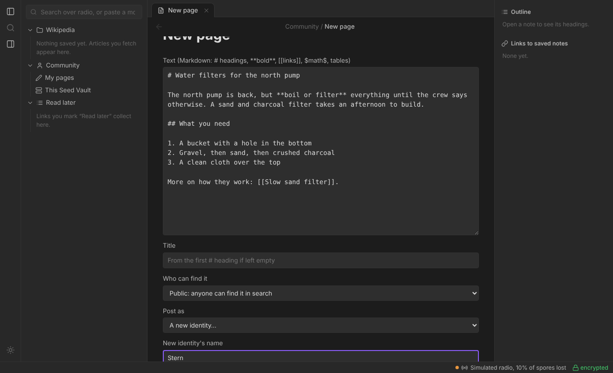

# Community pages

Anyone with a reader can write their own pages and publish them to a Seed
Vault, where others can find and read them, just like Wikipedia articles.
Pages are signed, so nobody can fake or quietly change yours.

**On this page:** [Identities](#identities) · [Page addresses](#page-addresses) ·
[Public and unlisted](#public-and-unlisted) · [Updating](#updating-restoring-and-deleting) ·
[Uploading and opening](#uploading-and-opening-pages) · [Finding pages](#finding-pages) ·
[Following](#following-and-favourites) · [Writing in the browser](#writing-in-the-browser) ·
[Trust](#what-makes-a-page-trustworthy)



---

## The quick way

1. In the browser reader (`moss web`), open **Community → My pages → New page**.
2. Write in Markdown (`# Title`, `**bold**`, `[[links]]`), and check the preview.
3. Choose who can find it (**public** or **unlisted**) and who it's from
   (you, or a fresh anonymous identity), then press **Sign and upload**.

Your pages are signed by an **identity** (a signing key); the editor
makes one for you if you don't have one yet. Back it up (below): without
it you can't update or delete your pages later.

The rest of this page explains each part, and the same things from the
command line. Community pages are being built in stages; what's still to
come (locked pages, owner tools) is on the [roadmap](roadmap.md).

## Identities

An author is a signing key. Your first one gets your display name and
becomes the default; you can hold as many as you like.

```bash
moss author new "Stern"
moss author list
moss author backup Stern stern-key.json   # asks for a passphrase
moss author restore stern-key.json        # on a new laptop
```

**Back up your identity.** Without the key you can never update or delete
pages you published with it. The backup file is encrypted with your
passphrase (scrypt + AES-256); keep the file and the passphrase in
different places.

Display names aren't unique, so every identity also has a fingerprint
(`98E1-228D-51E0-2612`) to tell two "Stern"s apart.

## Page addresses

```
moss:tdqsfdkr4atbevcpy7m6hf3rli/water-filters
     └───── author id ────────┘ └─ name ─┘
```

The author id is 128 bits of a hash of the author's key, so nobody can
make another key that claims your addresses. An address works on any vault
that carries the page.

## Public and unlisted

| | Public | Unlisted |
|---|---|---|
| In search | Yes, for everyone | Never |
| Listed under its author | Yes | Never |
| Download counts | Yes | Never |
| Opens from its link | Yes | Yes |
| Name in the address | Readable (`water-filters`) | Random (`~welybxz2x7ivrn7h`), so the link doesn't give the topic away |

An unlisted link still names its author, so someone holding it could look
up your public pages. To prevent that, post it from a fresh **anonymous
identity**: a nameless key made for that page alone. Your laptop keeps
it, so you can still update the page, but nothing links it to you.

```bash
moss page make water-filters.md                         # public, as your default identity
moss page make clinic-hours.md --unlisted --anonymous   # link-only, nothing ties it to you
moss page make notes.md --as "Other Name"               # a different identity of yours
```

The title comes from the file's first `# ` heading (or `--title`); the one
line shown in search is its first sentence (or `--about`). Pages can hold
everything articles do: links, `$math$`, tables, Key facts.

## Updating, restoring and deleting

```bash
moss page mine                                # what you've published
moss page update moss:<id>/water-filters new.md # becomes v2
moss page history moss:<id>/water-filters     # versions saved on this laptop
moss page restore moss:<id>/water-filters 1   # v1's text back, as v3
moss page delete moss:<id>/water-filters      # a signed "deleted" version
moss page check ~/.moss/outbox/<file>.mosspage --show
```

Every change is a new, higher version. Readers and vaults refuse a lower
version than one they've seen, so nobody can replay an old signed copy to
undo your fix. You can always bring old text back yourself with `restore`.

## Uploading and opening pages

```bash
moss page upload                           # everything waiting in the outbox
moss page upload moss:<id>/water-filters   # just that page
moss page open moss:<id>/water-filters     # read any page by its address
```

Or from the menu: *My pages → Upload to the Seed Vault* (a new page offers
to upload straight away), and *Open a page by address*. In the browser
reader, paste a `moss:` address into the search box.

How an upload goes:

1. Your reader sends an **offer**: the address, version and size, sealed
   to the vault like any request. A listener learns nothing, not even that
   it's an upload.
2. The vault checks it against its limits and answers at once if it can't
   take it ("too big: 400 spores, this Seed Vault's cap is 250"), so a
   refusal costs no airtime.
3. Otherwise it accepts. Your reader sends the page as spores, encrypted
   with a one-time key from both sides. The vault asks for any it missed
   (the same bare-patch repair as reading, in reverse), checks the author's
   signature and the version, stores the page and says "stored v2".

Uploads wait in the same queue as reads. After a successful upload the page
file moves to `~/.moss/outbox/sent/`. A failed one stays in the outbox to
try again.

Opening a page fetches it like an article, then checks the author's
signature, that it's the page asked for, and that it isn't older than a
version you've seen before. A page that fails any of these is blight and
isn't kept.

What the Seed Vault takes (it can change these; see
[Seed Vault options](seed-vault.md#seed-vault-options-worth-knowing)):

| Limit | Default |
|---|---|
| Biggest page | 250 spores (about 39 KB compressed) |
| Uploads per author per day | 3 (new pages, updates and deletions all count) |
| All uploads per day | 2,000 spores, about 55 minutes of airtime |
| Room for community pages | 2 GB |

The vault keeps the newest version of each page, exactly as its author
signed it, in `~/.moss/seed-vault/pages/`. A deletion is kept too, so an old
copy can't be uploaded again to bring the page back. Its log says "stored a
community page (12 spores)" without saying which, unless it runs with
`--log-queries`.

## Finding pages

Every search now shows two groups: **Wikipedia** and **Community** (the
vault's 10 best public pages; *More from the community* fetches the next 10).
Unlisted pages never appear.

How the Seed Vault ranks, the same for everyone:

1. **Text match**: words in the title count most, then the one-line
   description and author name, then the text.
2. **Link score**, like Google's original PageRank: a page scores higher
   when other authors link to it, more so when those authors are linked to
   themselves. Links count once per distinct *other* author (one author with
   fifty pages linking to themselves counts for nothing), and links inside
   locked pages are invisible to the vault.
3. **Downloads** (a plain count per public page: no who, no when) and
   **freshness** (a small boost in the first 30 days).

Then your reader re-sorts the results **on your device**: authors you follow
first, then your favourites, then pages your saved pages link to, then pages
you open most. None of that is ever sent, so no vault owner can see who
follows whom.

Each author's public pages are one tap away (*Their pages* on any page, or
`author:<id>` in a search). Links between pages work in both directions:
`[[moss:<address>|text]]` or a bare `moss:` address in a page opens it.

## Following and favourites

On any community page: **Follow** the author, ★ to favourite the page.
Favourites and saved pages sit in the **Community** folder on the left of
the browser reader. All of it lives in `~/.moss/social.json` on your device.

## Writing in the browser

*Community → My pages → New page* opens an editor: write Markdown, preview
it, choose public or unlisted and who it's from (yourself, a new anonymous
identity, or a new named identity), then **Sign and upload**. Your own
pages have an ✎ to publish a new version. `.md` files and the menu still
work as before.

## What makes a page trustworthy

A `.mosspage` file is a signed record plus the compressed text. The
record holds:

- the address, author name and key;
- title, one-line description, version and date;
- public or unlisted, deleted or not;
- the text's size and SHA-256 hash.

It's signed with Ed25519. A page is accepted only when:

- the signature checks;
- the key owns the address;
- the record is in its one exact (canonical) form;
- the text matches the size and hash.

Change any single byte and it's refused; the tests try every byte. Text
that would expand to more than 2 MB is refused too, so a page can't be a
compression bomb.
