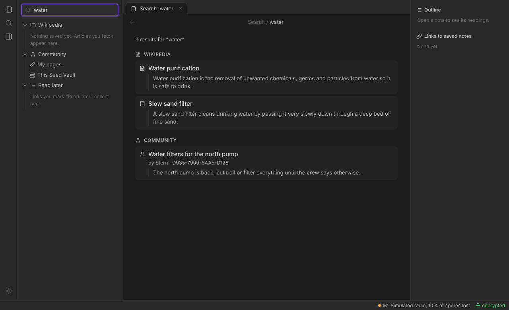
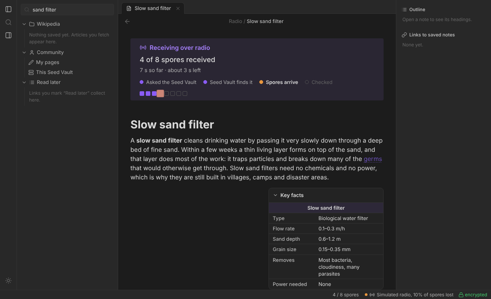
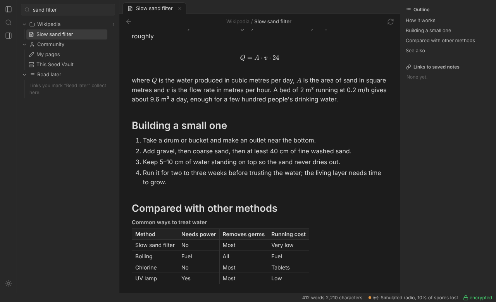
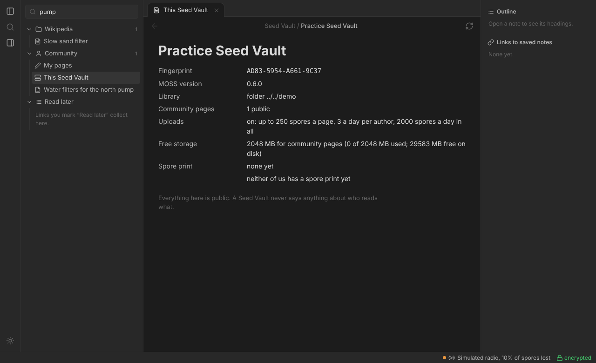

# Reader guide

Everything about the reader side: the laptop (or desktop, or Mac) with a
radio that searches, reads and saves articles. For the very first install,
see [Get started](../README.md#get-started).

**On this page:** [Setting up](#setting-up) ·
[Bluetooth radios](#bluetooth-radios-t1000-e-and-others) ·
[Updates](#updates-and-branches) · [Radio check](#radio-check) ·
[Using the reader](#using-the-reader) · [What's kept from Wikipedia](#whats-kept-from-wikipedia-and-what-isnt) ·
[Obsidian](#obsidian) · [Vault specs and spore prints](#vault-specs-and-spore-prints)

---

## Setting up

Where things live:

```
C:\Users\<you>\Documents\MOSS\             this repo, with .venv\ inside
C:\Users\<you>\.moss\cache\                saved articles and searches
C:\Users\<you>\.moss\vault.json            which Seed Vault this laptop trusts
<your Obsidian vault>\Wikipedia\           only if you run `moss export`
```

Setup, one command in PowerShell:

```powershell
irm https://raw.githubusercontent.com/Obsideaock/MOSS/main/install.ps1 | iex
```

It checks for Git and Python 3.10+ (offering to install them with winget),
puts MOSS in `C:\Users\<you>\MOSS` (or updates an existing `MOSS` or
`Documents\MOSS` checkout in place), makes the Python environment, adds the
`moss` command to your PATH, and runs `moss setup`, which finds the radio's
COM port, checks it answers, creates `#moss` on it if needed, and remembers
the port. Open a new terminal afterwards and type `moss`.

The commands, if you'd rather skip the menu:

```powershell
moss web                               # the browser reader
moss search "shrubbies band"           # search, pick, read
moss read "Boulder, Colorado"          # one article by title
moss cache                             # what's saved (no radio)
moss cache show "Boulder, Colorado"    # read a saved article offline
moss export C:\path\to\ObsidianVault   # saved articles -> notes
moss trust                             # which Seed Vault is trusted
```

`python -m moss ...` from inside the MOSS folder (with `.venv` active)
still works exactly the same.

## Bluetooth radios (T1000-E and others)

A reader can reach its radio over Bluetooth instead of a USB cable: same
MOSS, same encryption, same watchdog. It's the way to go with a T1000-E, or
when a computer won't show the radio's COM port.

1. The radio needs MeshCore's normal **Bluetooth companion** firmware (the
   one the phone app talks to).
2. **Disconnect it from the MeshCore phone app** (or turn the phone's
   Bluetooth off). A radio takes one Bluetooth connection at a time.
3. Run `moss setup` (or *Settings → Radio* in the menu), pick **Bluetooth
   instead** at the port question, and choose the radio from the scan
   (it shows up as `MeshCore-<its name>`).
4. If your computer asks for a pairing PIN, it's in the MeshCore app's
   settings for that radio (often `123456`). Setup offers to retry with a
   PIN if the first try fails. Pairing it once in the computer's own
   Bluetooth settings also works.

From then on everything uses it automatically. By hand: `moss web --ble`
(the first MeshCore radio found), `moss web --ble MeshCore-Stern`, or
`--ble <address>`; add `--pin 123456` if needed. `--port COM12` switches
back to a cable for that one run.

Bluetooth adds a little delay per message, which is small next to the
airtime itself. On Linux it needs BlueZ (standard on desktops and on
Raspberry Pi OS). The Seed Vault itself stays on USB.

## Updates and branches

`moss update` (or *Update MOSS* in the menu) gets the newest code from
GitHub. There are two branches:

| Branch | For |
|---|---|
| `main` | Stable. What every machine follows by default. |
| `experimental` | Newest changes, for testing before they go to main. |

`moss update --branch experimental` switches this machine to testing (it's
remembered); `moss update --branch main` switches back. Updating only ever
moves forward: edits you made in the MOSS folder are set aside with
`git stash` (it tells you, and `git stash pop` brings them back), and if the
folder has commits GitHub doesn't, it stops and changes nothing. On the Pi
it restarts the Seed Vault afterwards.

Publishing a change (on the machine you develop on):

```bash
git checkout experimental
# ...make changes...
git commit -am "what changed"
git push                          # testers: moss update --branch experimental
# once it's stable:
git checkout main
git merge experimental
git push                          # everyone else: moss update
```

## Radio check

To test whether two radios hear each other (and how far apart they can be),
run `moss radio-check listen` on one and `moss radio-check send` on the other,
or pick *Radio check* in the menu on both. It sends ten short numbered chat
messages on `#moss` and shows each one that arrives with its signal-to-noise
ratio. On the Pi it pauses the Seed Vault for the test and starts it again
afterwards. `moss radio-check info` shows the radio's frequency, bandwidth,
spreading factor and coding rate; two radios must match on all four to hear
each other at all.

---

## Using the reader

`moss web` opens a reader in your browser at
`http://127.0.0.1:8765`. It only listens on your own computer, works with no
internet (fonts, formulas and everything else are local), and looks and
behaves much like Obsidian.



- **Search** with the box at the top left (or Ctrl K). Results come back over
  the radio as a short list with a one-line description each.
- **Open** a result to request it. You'll see what's happening ("Asking the
  Seed Vault…", "Dormant behind 1 other request", "37 of 120 spores
  received", "4 spores didn't land. Asking again for the bare patches"), a
  grid of spores filling in, a time estimate, and the text itself appearing
  as it arrives.
- **Saved articles** are listed on the left and open instantly, no radio
  needed. The refresh button (circular arrow) fetches a fresh copy.
- **Links** in an article:
  - to an article you've saved: opens it straight away;
  - to anything else (dotted underline): click for **Get it now** or **Read
    later**. *Read later* collects titles in the left sidebar; click one to
    fetch it, and it drops off the list once it's saved.
- **Key facts**: the article's infobox, shown in a box beside the text.
- **Tables** come through in full, merged cells included.
- **Formulas** are drawn properly (KaTeX, bundled).
- **Outline** on the right lists the headings; **Links to saved notes**
  lists saved articles this one mentions.
- The **status bar** shows the radio (green), whether reading is encrypted
  (hover the lock for the Seed Vault's fingerprint), and turns red with
  *Radio disconnected, reconnecting…* if the radio drops out.





## What's kept from Wikipedia, and what isn't

| Kept | Left out (to save airtime) |
|---|---|
| All the article text, headings, lists (numbered lists keep their numbers) | Images (the nopic library has none) |
| Links between articles (as `[[wikilinks]]`) | Citations, footnote markers [1], References |
| Formulas (as LaTeX) | External links, Further reading, Notes sections |
| The infobox, as *Key facts* | Navigation boxes and sidebars |
| Data tables, in full | Kiwix's licence footer (the source line says the same) |
| *Italic*, **bold**, sub/superscripts (CO₂, 10⁻⁶, km²) | Invisible characters (zero-width spaces, soft hyphens) |
| "Main article: …" / "See also: …" notes, the *See also* list | |

Every article starts with a source line linking to the original on
wikipedia.org and stating its licence (CC BY-SA 4.0).

## Obsidian

`moss export <vault>` writes every saved article into
`<vault>\Wikipedia\` as a note: properties (title, source, licence, fetched
date, tags), a source callout, `[[links]]` that work in Obsidian's graph,
formulas Obsidian draws natively, tables as markdown tables, and *Key facts*
as a collapsible callout. It's safe to re-run; it only rewrites MOSS's own
notes. `--link-searches` also links titles that only appeared in search
results (they show as unresolved notes in the graph).

---

## Vault specs and spore prints

**Vault specs**: anyone can ask a Seed Vault about itself: *This Seed
Vault* in the browser reader, *This Seed Vault* in the menu, or
`moss vault-info`. It shows:

- name and fingerprint, and which MOSS it runs (and says so if it's older
  than yours: `moss update` on the Pi);
- its library;
- how many public community pages it has, and its upload limits;
- **free storage**: room left for community pages and free disk space;
- its spore print.

Specs never include anything private: nothing about readers or requests,
no read counts or logs, nothing about unlisted pages (not even how many),
no author behind any upload.



**Spore prints** are a vault's family tree, back to the original Seed Vault
at ATLAS, CU Boulder: *"2 hops from the original: ATLAS Seed Vault →
Lafayette → Longmont, since 2026-12-04"*.

- The original vault's owner starts it once: `moss spore-print "The original
  Seed Vault, ATLAS, CU Boulder, Colorado"` on the Pi (or *Spore print* in
  the Pi's menu), then restarts the vault. Installs never make one.
- Readers pick up a vault's print when they look at its specs, and give it
  to the next vault they meet that has none. That vault adds its own signed
  link and keeps that print forever.
- Every link is signed by its vault, all the way back to the original's
  key, so a print can't be faked, edited or cut short, and nobody can make a
  second "original" with the same fingerprint.
- **Prints never name readers**: a link says it was carried "via a reader",
  never which one, so prints can't show where anyone has been.
- Your reader's own print (the first vault it met) is shown only to you.

Anyone can start a separate family tree with their own vault. The original
is the one whose root fingerprint matches ATLAS's. Once the ATLAS vault has
its print, its fingerprint goes into MOSS (`KNOWN_ORIGINALS` in
`moss/sporeprint.py`) so readers can label it.
